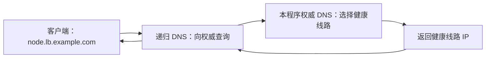

# Smart DNS LB


让多条 VLESS 线路共用一个域名，自动把新的 DNS 查询分配给健康线路，并按需要结合延迟、时段和剩余流量选择入口。

## 它解决什么问题

有多台入口机时，手动改客户端配置既麻烦，又容易一直用同一条线路。Smart DNS LB 在服务器上检查每条 VLESS 路径是否健康；客户端只需保留一个固定服务域名，解析时获得当前可用线路的入口 IP。



客户端拿到 IP 后直接连接线路入口，业务流量经过原来的 VLESS 路径。本程序负责 DNS 和健康探测。已有 DNS 缓存和长连接会继续生效，切换需要等待缓存到期或客户端重连。

使用前准备：一台有公网 IPv4 的 Linux 服务器、一个自己管理 DNS 的域名，以及至少一条可用的 VLESS TLS 链接。服务器和云安全组需放通 **UDP 53 和 TCP 53**。同一服务域名下的所有入口须接收相同的客户端端口、UUID、SNI 和传输参数，A 记录只携带 IP。

## 5 分钟快速开始

以下任选一种方式。建议先在服务器上完成安装，再通过 SSH 隧道打开面板；域名委派和缓存传播需要额外等待。

### 路线一：Ubuntu / Debian 一键脚本

```bash
git clone 'https://github.com/slfy123/smart-dns-lb'
cd smart-dns-lb
sudo bash install.sh
```

脚本创建 `smartdns` 服务用户、安装 Python 依赖、下载匹配架构的 Mihomo 并校验 SHA-256，然后启动 systemd 服务。默认面板地址为服务器上的 `http://127.0.0.1:8080`。

查看管理令牌：

```bash
sudo cat /var/lib/smart-dns-lb/admin.token
```

在自己电脑上执行以下命令，把 `服务器IP` 换成实际地址；保持这个 SSH 窗口开着：

```bash
ssh -L 18080:127.0.0.1:8080 root@服务器IP
```

浏览器打开 `http://127.0.0.1:18080`，输入令牌。默认仅在当前页面内存保存令牌；信任的个人浏览器可勾选“在此浏览器记住”，退出登录会清除。

以后升级：在仓库目录执行 `git pull`，再运行 `sudo bash install.sh`。数据和令牌保存在 `/var/lib/smart-dns-lb`。固定 Mihomo 版本、监听地址、跳过下载和卸载见 [进阶安装说明](docs/advanced.md#ubuntudebian-安装)。

### 路线二：Linux Docker Compose

先安装 Docker Engine 与 Compose 插件，然后执行：

```bash
git clone 'https://github.com/slfy123/smart-dns-lb'
cd smart-dns-lb
docker compose up -d --build
docker compose exec smart-dns-lb python app.py --show-token
```

默认镜像内置 Mihomo，使用 host 网络和持久数据卷。面板仍监听宿主机 `127.0.0.1:8080`，使用上面的 SSH 隧道访问。此 Compose 配置面向 Linux 宿主机；Windows 本地开发方法见 [进阶文档](docs/advanced.md#本地运行)。

升级时执行 `git pull` 与 `docker compose up -d --build`。普通 `docker compose down` 保留数据卷；含令牌的完整备份请妥善保存。

## 第一次进入：跟着六步向导走

配置未完成时，登录后会自动打开向导；也可从总览重新打开。

| 步骤 | 填什么 | 完成后的作用 |
| --- | --- | --- |
| 1 服务域名 | 如 `node.lb.example.com` | 自动生成独立子区 `lb.example.com` 和 NS 主机名，主域原来的网页、邮件记录继续由原 DNS 服务商管理 |
| 2 公网 IPv4 | 自动检测，检测失败时手填本机公网 IP | 告诉解析器在哪里找到本程序的权威 DNS |
| 3 导入节点 | 从 3x-ui / v2rayN 复制 VLESS 链接，可一次粘贴多条 | 预览后保存入口和探测参数；域名入口会解析为 IPv4 并显示提示 |
| 4 Mihomo | 自动检测安装路径；手动安装时填写绝对路径 | 用真实 VLESS 路径执行端到端探测 |
| 5 流量探针 | 可选：兼容探针地址和只读令牌 | 获取剩余流量；没有探针可先使用手动权重等模式 |
| 6 DNS 委派 | 按记录表到 DNS 服务商添加 NS 和 A/glue | 一键复制记录，再点“检查委派”验证 |

> 向导截图位：发布时补入使用示例域名的第 1 步与第 6 步截图。页面资源全部本地提供，无外部 CDN、字体或图标请求。

先等节点显示 **UP** 再让客户端使用服务域名。**DEGRADED** 表示线路仍可用但延迟偏高，**DOWN** 表示连续失败，**UNKNOWN** 表示尚未取得足够观测。停用节点显示灰色“已停用”，退出调度。

## DNS 委派图解

以你拥有 `example.com` 为例，只把独立子区交给本程序：

```text
example.com                  原 DNS 服务商继续管理
├── www.example.com          原网站记录
├── mail.example.com         原邮件记录
└── lb.example.com           NS → ns1.lb.example.com.
    ├── ns1.lb.example.com   A/glue → 203.0.113.10（运行本程序的服务器）
    └── node.lb.example.com  本程序按健康状态回答线路入口 IP
```

`203.0.113.10` 是文档地址，操作时换成本机公网 IPv4。在本程序中填写服务域名 `node.lb.example.com`，其余域名由向导生成。下表是在 **example.com 的父区 DNS 控制台** 添加的记录；名称栏通常会自动补全 `.example.com`。

| 服务商 | 记录类型 | 主机记录 / 名称 | 记录值 | 额外设置 |
| --- | --- | --- | --- | --- |
| Cloudflare | NS | `lb` | `ns1.lb.example.com` | 保持仅 DNS |
| Cloudflare | A | `ns1.lb` | `203.0.113.10` | **关闭代理，灰云 / DNS only** |
| 阿里云 DNS | NS | `lb` | `ns1.lb.example.com` | 解析线路：默认 |
| 阿里云 DNS | A | `ns1.lb` | `203.0.113.10` | 解析线路：默认 |
| DNSPod | NS | `lb` | `ns1.lb.example.com` | 线路类型：默认 |
| DNSPod | A | `ns1.lb` | `203.0.113.10` | 线路类型：默认 |

TTL 可保留服务商默认值。NS 的值是主机名，A 的值是 IPv4；有的控制台接受末尾的点，有的会自动处理。若服务商要求单独登记 glue / 子域名服务器主机记录，按向导表登记 `ns1.lb.example.com → 本机公网 IPv4`，再使用委派检测核对父区是否返回地址。

保留注册商原来的 `example.com` 域名服务器设置。检查并清理与 `lb` 委派冲突的旧 CNAME/托管记录。在父区给 `node` 添加普通 A 记录并不会建立委派；服务 IP 应由本程序回答。

完成后，在向导第 6 步点击“检查委派”。它分别检查父区、公共递归和服务 A 记录；委派已生效但节点尚未健康时，会单独提示服务解析问题。安装了 `dig` 也可运行：

```bash
dig @203.0.113.10 node.lb.example.com A
dig +trace node.lb.example.com A
```

第一条确认程序直接回答，第二条确认互联网能沿父区找到它。第一条成功而第二条失败，重点查 NS/glue、UDP/TCP 53、防火墙和云安全组。缓存尚未过期时，可等待原 TTL 后重试。

## 调度模式怎么选

所有模式先排除停用、维护和健康不可用节点。权重为 0 表示退出分配。以下比例指新的权威 DNS 查询，实际字节流量还受客户端缓存和长连接影响。

| 面板模式 / 配置值 | 白话说明 | 适用场景 |
| --- | --- | --- |
| 手动权重 `WEIGHTED` | 按设置的权重随机分配，如 60:40 | 先跑通系统，或套餐容量差异固定 |
| 最低延迟 `LOWEST_RTT` | 优先本机探测延迟最低的线路，有保持期避免频繁切换 | 追求服务器观测到的低延迟 |
| 主备 `FAILOVER` | 数字较小的优先级先用，同级按权重分配 | 一主一备；该模式优先使用 UP 节点 |
| 分时 `SMART_PEAK` | 平峰先 NORMAL、高峰先 PREMIUM，组内优先 UP，再按权重分配 | 高峰启用优化线路 |
| 流量感知 `TRAFFIC_AWARE` | 综合剩余额度、计费进度、套餐带宽和实时余量平滑调整 | 有完整探针指标，想兼顾容量和月度流量 |
| 剩余流量 `TRAFFIC_REMAINING` | 按绝对剩余 GiB 比例分配 | 套餐主要按流量计费，希望月末接近用完 |
| 分时 + 优先级 + 剩余流量 `SMART_PEAK_REMAINING` | 先选时段组，再选组内优先级，最后按剩余流量分配 | 多组线路并有明确主备顺序 |

默认模式为 `TRAFFIC_AWARE`；没有有效探针数据时退回基础权重。流量模式中达到额度停用阈值的节点退出调度，指标过期会退回基础权重。默认高峰 `19:30–00:00` 使用北京时间，包含开始、不包含结束；结束填 `24:00` 也按午夜处理。**开始与结束相同表示全天高峰**，例如 `00:00–00:00` 或 `00:00–24:00`；全天使用高峰分组优先规则。升级保留已有时段。

所有线路都不可用时，默认返回 SERVFAIL。可选 `LAST_KNOWN` 只在有限宽限期内尝试最近认证成功的线路；它仍可能已经失效，详见 [完整调度和健康语义](docs/advanced.md)。

## FAQ

### 53 端口被占用

先运行 `sudo ss -lntup 'sport = :53'` 查看占用者。常见是 systemd-resolved 的本地 stub。可在它的配置中设置 `DNSStubListener=no`，同时按系统实际情况保留有效的 `/etc/resolv.conf` 上游解析，再重启相关服务。安装脚本会打印操作指引，系统 DNS 配置由你确认后调整。

若机器有多个地址，可用 `sudo DNS_HOST=本机网卡IP bash install.sh` 只绑定指定网卡；NAT 环境用本机实际拥有的地址。此监听覆盖保存在 systemd，优先于面板设置；公网权威 DNS 仍需能通过标准 53 端口访问。仅本地调试可用 15353，公网递归解析器不会自动使用它。

### 委派不生效

确认操作的是父区 `example.com`，NS 名称填 `lb`，值填 `ns1.lb.example.com`，并补 A/glue。Cloudflare 的 A 记录必须灰云。分别验证直查与 `+trace`，检查 UDP/TCP 53、云安全组、NAT 映射；原记录仍在缓存时等待 TTL。向导诊断能区分委派问题与线路全部不健康。

### 全部节点 DOWN 或 UNKNOWN

先检查事件页、Mihomo 路径与版本，再核对 UUID、Encryption、SNI、入口端口和传输参数；导入原始 VLESS 链接更容易保持一致。没有 UUID 或就绪探测出口时是 UNKNOWN；只有 TCP 端口连通并不代表 VLESS 健康。服务器需要能访问所配 HTTPS 探测目标，目标与线路外控制检查同时失败会记为观测不确定。修复后点“探测”，连续成功和恢复稳定期完成后会重新加入调度。

### 面板打不开

默认只监听回环地址，请先建立 SSH 隧道，再打开自己电脑的 `http://127.0.0.1:18080`。查看 `sudo systemctl status smart-dns-lb`、`sudo journalctl -u smart-dns-lb -n 100`；Docker 用 `docker compose logs --tail 100`。调整监听设置后重启服务。需要远程公开访问时配置 HTTPS 反向代理，并保护管理令牌。

### 忘记令牌

脚本安装可查看 `sudo cat /var/lib/smart-dns-lb/admin.token`。重置并重启：

```bash
sudo -u smartdns /opt/smart-dns-lb/.venv/bin/python /opt/smart-dns-lb/app.py --data-dir /var/lib/smart-dns-lb --reset-token
sudo systemctl restart smart-dns-lb
```

Docker 用户运行：

```bash
docker compose exec smart-dns-lb python app.py --reset-token
docker compose restart smart-dns-lb
```

新令牌会打印到终端。浏览器里退出旧会话，再用新令牌登录。详细凭据、备份和 Windows 权限说明见 [进阶文档](docs/advanced.md#稳定性与运行边界)。

## 进阶文档

- [运行、完整调度语义、Mihomo、CLI、备份与 API](docs/advanced.md)
- [探针字段映射、计费口径和第三方适配](docs/probe-integration.md)
- [版本变更与明确的调度 bug 修复](CHANGELOG.md)
- [开源发布计划](docs/open-source-plan.md)

单台权威 DNS 仍是单点，生产部署应规划第二权威节点或托管 DNS/GTM。程序改善新连接的线路分配，客户端实际故障恢复时间请按自己的缓存、TTL 和连接复用配置测量。
